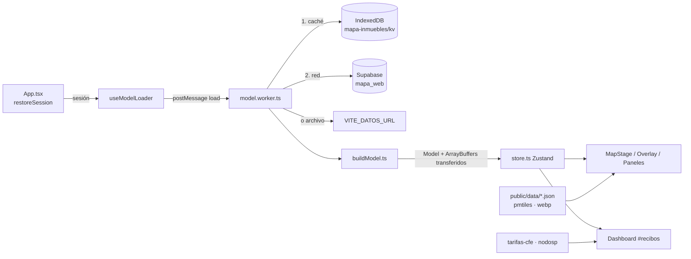

# Mapa de Inmuebles · Tamaulipas

Aplicación web para visualizar el **consumo, la demanda y el costo de energía eléctrica de los inmuebles de gobierno en Tamaulipas**. Combina un mapa interactivo (MapLibre GL) con un tablero analítico de recibos de CFE que contrasta lo facturado con las **tarifas oficiales de CFE** y el **catálogo de NodosP del CENACE**.

Los datos de inmuebles y su historial de recibos se leen de **Supabase** (esquema `mapa_web`). La cartografía, el mapa de calles y los catálogos oficiales son archivos estáticos dentro de `public/`.

---

## Índice

1. [Qué hace](#1-qué-hace)
2. [Tecnologías](#2-tecnologías)
3. [Requisitos](#3-requisitos)
4. [Instalación y arranque rápido](#4-instalación-y-arranque-rápido)
5. [Variables de entorno](#5-variables-de-entorno)
6. [Scripts de npm](#6-scripts-de-npm)
7. [Estructura del proyecto](#7-estructura-del-proyecto)
8. [La carpeta `public/`](#8-la-carpeta-public)
9. [Supabase: esquema, vistas y autenticación](#9-supabase-esquema-vistas-y-autenticación)
10. [Modo archivo local (sin Supabase)](#10-modo-archivo-local-sin-supabase)
11. [Arquitectura y flujo de datos](#11-arquitectura-y-flujo-de-datos)
12. [El mapa](#12-el-mapa)
13. [El tablero de recibos (`#recibos`)](#13-el-tablero-de-recibos-recibos)
14. [Scripts de datos oficiales (CFE y CENACE)](#14-scripts-de-datos-oficiales-cfe-y-cenace)
15. [Parámetros configurables](#15-parámetros-configurables)
16. [Despliegue](#16-despliegue)
17. [Rendimiento](#17-rendimiento)
18. [Seguridad y privacidad](#18-seguridad-y-privacidad)
19. [Solución de problemas](#19-solución-de-problemas)
20. [Tareas de mantenimiento frecuentes](#20-tareas-de-mantenimiento-frecuentes)
21. [Notas y pendientes conocidos](#21-notas-y-pendientes-conocidos)
22. [Créditos y fuentes de datos](#22-créditos-y-fuentes-de-datos)

---

## 1. Qué hace

### Mapa (`/` o `#mapa`)

- Muestra todos los inmuebles con coordenadas como puntos sobre el estado de Tamaulipas.
- **Tres niveles de vista** según el zoom:
  1. **Regiones principales** (zoom < 8.5): píldoras con el agregado de cada una de las 20 zonas.
  2. **Subgrupos** (8.5 ≤ zoom < 12): píldoras por subgrupo dentro de cada zona (k-means) y puntos individuales.
  3. **Inmuebles individuales** (zoom ≥ 12): solo puntos, con mapa de calles (desde zoom 11).
- **Colorear por** medidas del recibo (consumo kWh, precio $/kWh, demanda kW) o por características (dependencia, tarifa, interconexión fotovoltaica/NETMET, ubicación validada).
- **Filtros** por dependencia y por mes de fin del último recibo.
- **Línea de tiempo** de 13 meses (feb 2025 – feb 2026) con reproducción automática y barra de cobertura por mes.
- **Tarjeta al pasar el cursor** sobre un punto y **panel lateral** con el detalle del inmueble: datos generales, promedios de los últimos 12 meses y cuatro gráficas del historial completo (consumo, demanda, importe y precio por kWh).
- Leyenda con escala logarítmica por percentiles 2–98, interruptor para ocultar puntos, controles de zoom.

### Tablero de recibos (`#recibos`)

- Cinco pestañas: **General**, **Demanda**, **Zonas**, **Catálogo NodosP** y **Validación y metodología**.
- Filtros por dependencia, tarifa, municipio y zona de carga (NodoP).
- Costeo de cada mes con importe del recibo, precio impreso o tabla oficial de CFE.
- Validación automática de lecturas de demanda (kW) y estimación de demanda para recibos sin lectura.
- Modo claro / oscuro y hoja de estilos de impresión.

---

## 2. Tecnologías

| Paquete | Versión | Uso |
|---|---|---|
| `react` / `react-dom` | ^18.3.1 | Interfaz |
| `zustand` | ^5.0.2 | Estado global (mes, filtros, selección, modelo) |
| `maplibre-gl` | 4.7.1 (fija) | Motor de mapa vectorial |
| `pmtiles` | 4.5.0 (fija) | Lectura de teselas desde un solo archivo `.pmtiles` por *Range requests* |
| `@protomaps/basemaps` | 5.7.2 (fija) | Estilo de capas del mapa de calles (OpenStreetMap) |
| `chart.js` | ^4.4.1 | Gráficas del tablero de recibos |
| `@fontsource/lato` | ^5.1.0 | Tipografía del mapa |
| `@fontsource/ibm-plex-sans` | ^5.1.0 | Tipografía del tablero |
| `vite` + `@vitejs/plugin-react` | ^5.4.11 / ^4.3.4 | Servidor de desarrollo y compilación |
| `typescript` | ^5.6.3 | Tipado estricto (`strict: true`) |
| `cheerio` (dev) | ^1.2.0 | Scraper de tarifas CFE |
| `xlsx` (dev) | ^0.18.5 | Lectura del catálogo NodosP del CENACE |

Las versiones de MapLibre, PMTiles y Protomaps están fijadas a propósito: el estilo del mapa base depende de la API exacta de `@protomaps/basemaps` (`namedFlavor`, `layers`) y del formato de sprites `v4`.

---

## 3. Requisitos

- **Node.js 18 o superior** (recomendado 20 LTS). Los scripts de `scripts/` usan `fetch` nativo y `Headers.getSetCookie()` (Node ≥ 19.7; en versiones anteriores hay un respaldo).
- **npm** (el repositorio incluye `package-lock.json`).
- Un proyecto de **Supabase** con el esquema `mapa_web` expuesto (ver §9), o bien un archivo JSON local (ver §10).
- Un servidor que admita **peticiones parciales HTTP (`Range`)** para servir el `.pmtiles` (Vite lo hace en desarrollo).

---

## 4. Instalación y arranque rápido

```bash
# 1. Dependencias
npm install

# 2. Variables de entorno
cp .env.example .env
#    edita .env y coloca VITE_SUPABASE_URL y VITE_SUPABASE_ANON_KEY

# 3. Verifica que existan los archivos estáticos (ver §8)
#    public/tamaulipas-lite.pmtiles, public/basemap-assets/, public/data/*.json, public/data/suelo-*.webp

# 4. (Opcional) Genera o actualiza los catálogos oficiales
node scripts/scrape-tarifas-cfe.mjs
node scripts/scrape-nodosp-cenace.mjs

# 5. Servidor de desarrollo
npm run dev          # http://localhost:5173
```

Para compilar y probar la versión de producción:

```bash
npm run build        # revisa tipos y genera dist/
npm run preview      # sirve dist/ localmente
```

---

## 5. Variables de entorno

Archivo `.env` (plantilla en `.env.example`). Vite solo expone al navegador las variables con prefijo `VITE_`.

| Variable | Obligatoria | Descripción |
|---|---|---|
| `VITE_SUPABASE_URL` | Sí (salvo modo archivo) | URL del proyecto, p. ej. `https://abcdxyz.supabase.co` |
| `VITE_SUPABASE_ANON_KEY` | Sí (salvo modo archivo) | Llave **anon / publishable**. **Nunca** la `service_role`. |
| `VITE_DATOS_URL` | No | Ruta a un JSON con `{ inmuebles, historial, zonas?, zonaMunicipio? }`. Si está definida, la app **no usa Supabase ni pide inicio de sesión** (ver §10). Ejemplo: `/data/demo.json` |

> En Supabase hay que agregar el esquema `mapa_web` en **Project Settings → Data API → Exposed schemas**; si no, PostgREST responde 406/404 a las consultas.

Si faltan `VITE_SUPABASE_URL` o `VITE_SUPABASE_ANON_KEY` y no hay `VITE_DATOS_URL`, el mapa se dibuja vacío y aparece un aviso.

---

## 6. Scripts de npm

| Comando | Qué hace |
|---|---|
| `npm run dev` | Servidor de desarrollo de Vite con recarga en caliente |
| `npm run build` | `tsc --noEmit` (verificación de tipos) y `vite build` → `dist/` |
| `npm run preview` | Sirve `dist/` para probar la compilación |
| `npm run typecheck` | Solo verificación de tipos |

Scripts de Node (no están en `package.json`, se corren directo):

| Comando | Salida |
|---|---|
| `node scripts/scrape-tarifas-cfe.mjs` | `public/data/tarifas-cfe-tamaulipas.json` |
| `node scripts/scrape-nodosp-cenace.mjs` | `public/data/nodosp-tamaulipas.json` |

Opciones detalladas en §14.

---

## 7. Estructura del proyecto

```
mapa-inmuebles/
├── index.html                  # Punto de entrada; precarga estado.json y municipios.json
├── package.json
├── package-lock.json
├── tsconfig.json               # ES2022, strict, moduleResolution Bundler, jsx react-jsx
├── vite.config.ts              # Plugin React, workers ES, trozos manuales maplibre/basemap
├── .env.example
│
├── public/                     # Archivos estáticos servidos tal cual (ver §8)
│   ├── tamaulipas-lite.pmtiles
│   ├── basemap-assets/
│   │   ├── fonts/…
│   │   └── sprites/v4/…
│   └── data/
│       ├── estado.json
│       ├── municipios.json
│       ├── vecinos.json
│       ├── suelo-n.webp
│       ├── suelo-s.webp
│       ├── tarifas-cfe-tamaulipas.json
│       ├── nodosp-tamaulipas.json
│       └── demo.json            # opcional (modo archivo local)
│
├── scripts/
│   ├── scrape-tarifas-cfe.mjs   # Descarga tarifas de «Conoce tu tarifa» (CFE)
│   ├── scrape-nodosp-cenace.mjs # Descarga y filtra el Catálogo de NodosP (CENACE)
│   └── .debug/                  # (se crea solo) HTML/JSON de diagnóstico de los scrapers
│
└── src/
    ├── main.tsx                 # Monta <App/>, carga fuentes Lato, CSS de MapLibre y estilos
    ├── App.tsx                  # Sesión, login, enrutado mapa/recibos, carga del modelo
    ├── route.ts                 # Rutas por hash (#recibos) sin librería de rutas
    ├── store.ts                 # Estado global con Zustand
    ├── styles.css               # Estilos del mapa (topbar, paneles, píldoras, leyenda…)
    │
    ├── auth/
    │   └── auth.ts              # Login con Supabase Auth (REST), renovación y cierre de sesión
    │
    ├── data/
    │   ├── types.ts             # Tipos: RawData, Prop, Model, Scale, ZoneInfo, SubInfo…
    │   ├── useModelLoader.ts    # Arranca el Web Worker y conecta sus mensajes con el store
    │   ├── model.worker.ts      # Worker: Supabase paginado, caché IndexedDB, modo archivo
    │   └── buildModel.ts        # Construye el modelo: matrices tipadas, zonas, subgrupos, escalas, GeoJSON
    │
    ├── lib/
    │   ├── constants.ts         # CONFIG, paletas, niveles de zoom, uso de suelo, etiquetas de contexto
    │   ├── zonasDefault.ts      # 20 zonas y la asignación de los 43 municipios (integradas)
    │   ├── scales.ts            # Escala logarítmica por percentiles y rampa de color
    │   ├── selectors.ts         # Filtros, agregados por zona/subgrupo, historial de un inmueble
    │   ├── categories.ts        # Etiqueta de categoría de un inmueble por modo
    │   ├── format.ts            # Formatos es-MX, normalización de nombres, PRNG mulberry32
    │   └── useVisible.ts        # Hook: índices de inmuebles que pasan los filtros
    │
    ├── map/
    │   ├── MapStage.tsx         # Crea el mapa, añade puntos, aplica estilo/filtros, monta paneles
    │   ├── mapStyle.ts          # Estilo base: vecinos, estado, municipios, uso de suelo
    │   ├── basemap.ts           # Mapa de calles Protomaps desde el .pmtiles (carga diferida)
    │   ├── points.ts            # Fuente GeoJSON de puntos, capas y expresiones de color/filtro
    │   ├── overlayEngine.ts     # Motor imperativo de píldoras (colocación sin encimarse, líneas guía)
    │   ├── usePointInteractions.ts # Hover y clic sobre píldoras y puntos
    │   └── assets.ts            # assetUrl(): URL absoluta de un archivo de /public
    │
    ├── components/
    │   ├── TopBar.tsx           # Título, conteo, «Colorear por», filtros, switch de puntos, Recibos, Salir
    │   ├── Login.tsx            # Formulario de inicio de sesión
    │   ├── Overlay.tsx          # Píldoras de zonas/subgrupos y etiquetas de contexto
    │   ├── BottomPanel.tsx      # Leyenda + línea de tiempo con reproducción
    │   ├── SidePanel.tsx        # Detalle del inmueble seleccionado con gráficas
    │   ├── HoverCard.tsx        # Tarjeta flotante al pasar sobre un punto
    │   ├── Chart.tsx            # Gráfica de barras SVG del historial (sin dependencias)
    │   ├── ZoomControls.tsx     # Botones + / −
    │   ├── Toast.tsx            # Avisos temporales
    │   └── common.tsx           # FeatChips, SrcMark, histStats, ventana12, endLabel…
    │
    └── dash/                    # Tablero de recibos (se carga de forma diferida)
        ├── Dashboard.tsx        # Pestañas, filtros, KPIs, gráficas Chart.js, tablas
        ├── dashboard.css        # Estilos del tablero (claro/oscuro, responsivo, impresión)
        ├── rows.ts              # Aplanado del historial, validación y estimación de demanda
        ├── tarifas.ts           # Carga de JSON oficiales, costeo con tabla CFE, zona de carga
        └── historial.ts         # Utilidad para convertir registros a columnas (no se usa aún)
```

---

## 8. La carpeta `public/`

Todo lo que está en `public/` se sirve en la raíz del sitio sin procesar. El código siempre construye las rutas con `assetUrl()` (`src/map/assets.ts`), que antepone `import.meta.env.BASE_URL` y genera una URL absoluta: **MapLibre lee desde Web Workers, que no resuelven rutas relativas**.

> El repositorio comprimido puede no incluir `public/` por su tamaño. Sin estos archivos la app sigue funcionando parcialmente (ver la columna «Si falta»).

### 8.1 Resumen

| Ruta | Lo usa | Formato | Si falta |
|---|---|---|---|
| `tamaulipas-lite.pmtiles` | `map/basemap.ts` | PMTiles v3 (vector, esquema Protomaps) | El mapa funciona **sin calles**; aviso en consola |
| `basemap-assets/fonts/{fontstack}/{range}.pbf` | `map/basemap.ts` | Glifos SDF de MapLibre | No se dibujan etiquetas del mapa de calles |
| `basemap-assets/sprites/v4/white(.json/.png/@2x)` | `map/basemap.ts` | Sprite de MapLibre | Faltan íconos del mapa de calles |
| `data/estado.json` | `map/mapStyle.ts`, `index.html` (preload) | GeoJSON | Sin contorno ni sombra del estado |
| `data/municipios.json` | `map/mapStyle.ts`, `index.html` (preload) | GeoJSON con propiedad `cve` | Sin municipios ni resaltado por zona |
| `data/vecinos.json` | `map/mapStyle.ts` | GeoJSON | Sin estados vecinos de fondo |
| `data/suelo-n.webp` | `map/mapStyle.ts` vía `USO_SUELO` | Imagen WebP georreferenciada | Sin uso de suelo (mitad norte) |
| `data/suelo-s.webp` | `map/mapStyle.ts` vía `USO_SUELO` | Imagen WebP georreferenciada | Sin uso de suelo (mitad sur) |
| `data/tarifas-cfe-tamaulipas.json` | `dash/tarifas.ts` | JSON propio (ver §14.1) | Tablero sin costeo con tabla CFE; aviso con el comando para generarlo |
| `data/nodosp-tamaulipas.json` | `dash/tarifas.ts` | JSON propio (ver §14.2) | Pestaña «Catálogo NodosP» vacía; todos los inmuebles quedan en «Sin nodo» |
| `data/demo.json` | `data/model.worker.ts` si `VITE_DATOS_URL` | JSON (ver §10) | Solo se usa en modo archivo local |

### 8.2 `tamaulipas-lite.pmtiles` — mapa de calles

- Teselas vectoriales de OpenStreetMap en el esquema de **Protomaps**, recortadas a Tamaulipas.
- Se lee con el protocolo `pmtiles://` registrado en MapLibre (`maplibregl.addProtocol("pmtiles", …)`).
- Antes de instalarlo, `basemap.ts` hace una petición `Range: bytes=0-6` y comprueba que la respuesta sea **206** y empiece con la firma `PMTiles`. Si el servidor no admite `Range` o el archivo no existe, se omite el mapa de calles sin romper nada.
- Todas sus capas se agregan con prefijo `pm_` y `minzoom` = `ZOOM_CALLES` (11), **debajo** de la capa de puntos.
- Se eliminan las capas `background`, `places_region`, `places_country`, `water_label_ocean`, `roads_oneway` y `address_label`.
- Paleta propia sobre el *flavor* `white` (tierra cálida, agua azul grisácea, calles blancas).
- Idioma de etiquetas: español (`lang: "es"`).

**Cómo regenerarlo (sugerencia):** con la herramienta [`pmtiles`](https://github.com/protomaps/go-pmtiles) se puede extraer la región de un *build* diario de Protomaps:

```bash
pmtiles extract https://build.protomaps.com/AAAAMMDD.pmtiles public/tamaulipas-lite.pmtiles \
  --bbox=-100.3,22.1,-97.0,27.8 --maxzoom=15
```

Ajusta la caja y el `maxzoom` para equilibrar tamaño y detalle (el mapa permite hasta zoom 16; MapLibre sobreescala la última tesela).

### 8.3 `basemap-assets/` — fuentes y sprites

Estructura esperada (la del repositorio [protomaps/basemaps-assets](https://github.com/protomaps/basemaps-assets)):

```
basemap-assets/
├── fonts/
│   ├── Lato Regular/0-255.pbf, 256-511.pbf, …
│   ├── Lato Bold/…
│   ├── Lato Italic/…
│   └── Noto Sans Regular/ … (solo si se usa tipografia "Noto Sans")
└── sprites/
    └── v4/
        ├── white.json
        ├── white.png
        ├── white@2x.json
        └── white@2x.png
```

- `map.setGlyphs(".../basemap-assets/fonts/{fontstack}/{range}.pbf")`
- `map.setSprite(".../basemap-assets/sprites/v4/white")`
- Con `tipografia: "Lato"` (la que usa `MapStage.tsx`) las fuentes de Protomaps se traducen así: `Noto Sans Regular → Lato Regular`, `Noto Sans Medium → Lato Bold` (Lato no tiene *Medium*), `Noto Sans Italic → Lato Italic`. Por eso **deben existir las carpetas `Lato Regular`, `Lato Bold` y `Lato Italic`**. Si no tienes los PBF de Lato, se pueden generar con [`font-maker`](https://github.com/maplibre/font-maker) a partir de los TTF, o cambiar a `tipografia: "Noto Sans"`.

### 8.4 `data/estado.json`, `data/municipios.json`, `data/vecinos.json` — límites

GeoJSON en WGS84 (EPSG:4326). Se pasan **por URL** a MapLibre, que los procesa en su propio worker, de modo que el mapa se dibuja antes de que lleguen los datos de Supabase. `index.html` precarga `estado.json` y `municipios.json` con `<link rel="preload">`.

| Archivo | Contenido | Capas |
|---|---|---|
| `estado.json` | Polígono de Tamaulipas | `state-shadow-far/mid/near` (sombra en tres desplazamientos), `state-line` |
| `municipios.json` | 43 municipios. **Cada *feature* debe tener `properties.cve`** con la clave INEGI de 3 dígitos (`"001"`…`"043"`) | `mun-fill`, `mun-tint` (resaltado de los municipios de la zona bajo el cursor), `mun-line` |
| `vecinos.json` | Estados vecinos / contexto (Texas, Nuevo León, San Luis Potosí, Veracruz) | `neigh-fill`, `neigh-line` |

Fuentes indicadas en la atribución del mapa: **INEGI 2022** (Marco Geoestadístico) y **Natural Earth**.

La caja del estado está precalculada en `STATE_BBOX = [-100.145, 22.207, -97.1443, 27.6791]` (`lib/constants.ts`) para no tener que leer la geometría en el hilo principal. Si cambias `estado.json`, actualiza esa constante.

### 8.5 `data/suelo-n.webp` y `data/suelo-s.webp` — uso de suelo

- Ráster de **Uso del Suelo y Vegetación, INEGI Serie V**, dividido en dos mitades porque **algunos teléfonos no cargan texturas de más de 4 096 px**.
- Se colocan como fuentes `image` con estas esquinas (`USO_SUELO` en `lib/constants.ts`):

| Archivo | Esquinas (lon, lat): sup.-izq., sup.-der., inf.-der., inf.-izq. |
|---|---|
| `suelo-n.webp` | (-100.145, 27.6791), (-97.144627, 27.6791), (-97.144627, 24.974196), (-100.145, 24.974196) |
| `suelo-s.webp` | (-100.145, 24.974196), (-97.144627, 24.974196), (-97.144627, 22.207451), (-100.145, 22.207451) |

- Opacidad 0.92 hasta zoom 8.5 y se desvanece hasta 0 en zoom 10 (`SUELO_ZOOM`).
- Si regeneras las imágenes, mantén exactamente estas coordenadas o actualiza `USO_SUELO`.

### 8.6 `data/tarifas-cfe-tamaulipas.json` y `data/nodosp-tamaulipas.json`

Generados por los scripts de `scripts/` (formato completo en §14). El tablero los pide con `cache: "no-cache"` para que siempre tome la versión más reciente. Si alguno falla, el tablero lo indica en la franja superior con el comando para generarlo.

---

## 9. Supabase: esquema, vistas y autenticación

### 9.1 Configuración

En `src/lib/constants.ts`:

```ts
esquema: "mapa_web",
views: {
  inmuebles: "inmuebles",
  historial: "historial",
  zonas: null,          // opcional: vista con id, nombre, lat, lon
  zonaMunicipio: null   // opcional: vista con cve_mun, municipio, zona_id
},
pageSize: 1000,
concurrency: 8,
cacheMinutes: 10
```

Las consultas van a `/rest/v1/{vista}` con la cabecera `Accept-Profile: mapa_web`, paginando de 1 000 en 1 000 con `Range` y hasta 8 páginas en paralelo. La primera página pide `Prefer: count=exact` para conocer el total.

### 9.2 Vista `mapa_web.inmuebles`

Se pide con `select=*` ordenada por `id`. Columnas que usa la app:

| Columna | Tipo sugerido | Uso |
|---|---|---|
| `id` | int / uuid | Identificador; conserva la selección entre recargas |
| `nombre` | text | Nombre del inmueble (`"Sin nombre"` si falta) |
| `direccion` | text | Dirección |
| `rpu` | text | Número de servicio CFE. **Llave para unir con el historial** |
| `dependencia` | text | Dependencia (`"Sin dependencia"` si falta) |
| `tarifa` | text | Tarifa CFE (PDBT, GDBT, GDMTO, GDMTH, 1, 1A…1F, DAC…) |
| `municipio` | text | Municipio; se usa para asignar zona y grupo tarifario |
| `latitud`, `longitud` | numeric | Coordenadas; `0` o vacío = sin ubicación (no se dibuja) |
| `interconexion` | text | `FOTOVOLTAICO`, `NETMET` o nulo |
| `medidor_bidireccional` | boolean | Muestra la etiqueta «Medidor bidireccional» |
| `nodo` | text | NodoP capturado (clave CENACE) |
| `ubicacion_validada` | boolean / null | Modo «Ubicación validada» |
| `demanda_aplica` | boolean / null | `false` → la demanda se muestra como N/A |
| `historial_formato` | int | 1 = historial con precio impreso, 2 = con importe |
| `region_nombre` | text | Colonia/localidad; da nombre a los subgrupos |
| `region_tipo` | text | Etiqueta de la región (por omisión «Colonia») |
| `recibo_fin` | date | Fin del último recibo (`CONFIG.endColumn`). Si la columna no existe, se deduce del último mes con datos |

### 9.3 Vista `mapa_web.historial`

Se pide `select=rpu,periodo_inicio,kwh,kw,importe,precio_kwh,precio_fuente` ordenada por `rpu,periodo_inicio`.

| Columna | Uso |
|---|---|
| `rpu` | Se une con `inmuebles.rpu` |
| `periodo_inicio` | Fecha; se toma `AAAA-MM` como clave del mes |
| `kwh` | Consumo del periodo |
| `kw` | Demanda medida |
| `importe` | Importe facturado ($) |
| `precio_kwh` | Precio por kWh |
| `precio_fuente` | `impreso` (precio medio impreso en el recibo, formato 1) o `importe` (importe ÷ kWh, formato 2) |

### 9.4 Zonas (opcionales)

Por omisión se usan las **20 zonas integradas** y la asignación de los **43 municipios** de `src/lib/zonasDefault.ts`. Para administrarlas desde la base, crea dos vistas y asígnalas en `CONFIG.views.zonas` y `CONFIG.views.zonaMunicipio`:

- `zonas`: `id, nombre, lat, lon` (el punto `lat/lon` es el ancla de la píldora).
- `zona_municipio`: `cve_mun, municipio, zona_id`.

Si las vistas fallan o vienen vacías, se vuelve a las zonas integradas sin error.

Cada inmueble se asigna a la zona de su municipio (comparación sin acentos, minúsculas y sin el prefijo «Ciudad»/«Cd.»). Si el municipio no coincide, se asigna la **zona más cercana por coordenadas** y se registra un aviso en consola.

### 9.5 Autenticación

`src/auth/auth.ts` habla directamente con la API REST de Supabase Auth (sin `supabase-js`):

- **Inicio de sesión:** `POST /auth/v1/token?grant_type=password` con correo y contraseña.
- **Sesión guardada** en `localStorage` con la llave `mapa-inmuebles.sesion`.
- **Renovación:** si el token vence en menos de 60 s, se renueva con `grant_type=refresh_token`.
- **Token vencido durante la carga** (HTTP 401): el worker avisa y la app cierra la sesión.
- **Salir:** borra la sesión, **borra la base IndexedDB `mapa-inmuebles`** (el caché de datos es privado) y llama a `/auth/v1/logout`.
- Mensajes en español: «Correo o contraseña incorrectos.», «Falta confirmar el correo.».

Los usuarios se dan de alta en **Supabase → Authentication → Users** (la app no tiene registro).

### 9.6 Permisos (RLS)

Las peticiones llevan `apikey: <anon>` y `Authorization: Bearer <access_token del usuario>`. Para que solo usuarios autenticados lean los datos:

```sql
-- Ejemplo orientativo: ajústalo a tus tablas reales
grant usage on schema mapa_web to authenticated;
grant select on mapa_web.inmuebles, mapa_web.historial to authenticated;
-- Si las vistas leen tablas con RLS, crea políticas de SELECT para el rol authenticated
-- y considera "security_invoker = true" en las vistas (Postgres 15+).
```

---

## 10. Modo archivo local (sin Supabase)

Útil para demostraciones o desarrollo sin conexión:

```env
VITE_DATOS_URL=/data/demo.json
```

- No pide inicio de sesión ni consulta Supabase.
- La barra superior muestra la etiqueta **«Muestra precargada»**.
- Formato del archivo (coloca `demo.json` en `public/data/`):

```json
{
  "inmuebles": [
    { "id": 1, "nombre": "Oficina Central", "direccion": "Calle 1", "rpu": "123456789012",
      "dependencia": "Secretaría X", "tarifa": "GDMTO", "municipio": "Victoria",
      "latitud": 23.736, "longitud": -99.146, "interconexion": null,
      "medidor_bidireccional": false, "nodo": "05VIC-115", "ubicacion_validada": true,
      "demanda_aplica": true, "historial_formato": 2, "region_nombre": "Centro",
      "region_tipo": "Colonia", "recibo_fin": "2026-02-15" }
  ],
  "historial": [
    { "rpu": "123456789012", "periodo_inicio": "2026-01-01", "kwh": 12500, "kw": 48,
      "importe": 41800, "precio_kwh": 3.34, "precio_fuente": "importe" }
  ],
  "zonas": [],
  "zonaMunicipio": []
}
```

`zonas` y `zonaMunicipio` son opcionales; si se omiten se usan las integradas. Si el archivo no se puede leer, el mapa queda vacío con un aviso.

---

## 11. Arquitectura y flujo de datos



### 11.1 Arranque

1. `App.tsx` restaura la sesión (o muestra `Login`). En modo archivo usa una sesión ficticia.
2. Con sesión, `Authed` monta `useModelLoader` **y en paralelo** `MapStage`, que crea el mapa de inmediato con los límites y el uso de suelo.
3. El worker carga los datos y construye el modelo fuera del hilo principal.
4. Cuando llega el modelo, se agrega la fuente de puntos; el mapa de calles se instala al final, cuando el estilo base ya cargó.

### 11.2 Worker y caché (`model.worker.ts`)

- **Caché local** en IndexedDB (base `mapa-inmuebles`, almacén `kv`, llave `raw:<id de usuario>`) con `{ v, t, fp, raw }`.
- Si hay caché, se **pinta al instante** con él (`source: "cache"`). Si tiene menos de `cacheMinutes` (10 min), no se consulta Supabase.
- Si se consulta Supabase y la **huella** (hash FNV-1a del JSON de inmuebles + historial) coincide con la del caché, se responde `same` y no se reconstruye nada.
- Si la red falla y hay caché, se siguen mostrando los últimos datos con un aviso.
- Al cambiar el formato del caché, sube `CACHE_VERSION`.

Mensajes del worker: `model` (con `source`: `cache` | `red` | `archivo` | `vacio`), `same`, `auth`, `toast`.

### 11.3 Construcción del modelo (`buildModel.ts`)

El modelo evita miles de objetos y usa **matrices tipadas**, que se **transfieren sin copiar** al hilo principal:

- `kwh`, `kw`, `imp`, `pr`: `Float64Array` de N × M (inmuebles × meses de la línea de tiempo), `NaN` = sin dato.
- Historial completo en columnas planas: `histOff` (desplazamientos), `hKey` (mes codificado como `año·12 + mes − 24000` en `Uint16`), `hKwh`, `hKw`, `hImp`, `hPr`, `hSrc` (0 sin dato, 1 impreso, 2 importe).
- `catIdx`: índice de categoría por inmueble para cada modo; `depIdx`; `finCat` (0 = otro mes, 1 = ene 2026, 2 = feb 2026).
- **Zonas y subgrupos**: los subgrupos se calculan por zona con **k-means++ con semilla fija** (`mulberry32(1000 + id de zona)`), así son estables entre recargas. k = 1 si la zona tiene < 50 inmuebles; si no, entre 2 y 8 (`round(√n / 4)`). El nombre del subgrupo es la colonia/municipio del inmueble más cercano al centroide (con sufijo 2, 3… si se repite).
- **Escalas** de color por medida con todos los valores > 0 de todos los meses.
- **Mes inicial**: el último en el que al menos la mitad de los inmuebles con historial tiene registro.
- **GeoJSON de puntos** generado una sola vez como texto, con la clase de color de cada mes en propiedades planas (`k0…`, `p0…`, `w0…`). En el hilo principal se convierte en un `Blob` y MapLibre lo procesa en su worker.

### 11.4 Estado global (`store.ts`)

`model`, `loading`, `source`, `toast`, `month`, `colorBy`, `dep`, `fin`, `ptsOn`, `playing`, `selected`, `hoverPoint`, `hoverKey`, `view`. Cuando llegan datos frescos de un modelo del mismo tamaño, **se conservan** el mes, el filtro y el inmueble seleccionado.

### 11.5 Rutas

`route.ts` usa el hash: `#recibos` abre el tablero; cualquier otro valor, el mapa. No hace falta configurar reescrituras en el servidor. El tablero se carga con `lazy()` (trozo aparte con Chart.js e IBM Plex Sans); el modelo se comparte, sin otra consulta.

---

## 12. El mapa

### 12.1 Configuración de la cámara

- Encuadre inicial a `STATE_BBOX` con márgenes que respetan el panel inferior.
- `maxZoom: 16`, `minZoom` = zoom de encuadre − 1.2 (mínimo 3.5), `maxBounds` = [-106.5, 17] – [-89, 31.5].
- Rotación e inclinación desactivadas.
- Atribución compacta: «Límites: INEGI 2022 · Natural Earth · Uso de suelo: INEGI Serie V» + OpenStreetMap / Protomaps.

### 12.2 Orden de capas

`neigh-fill` → `neigh-line` → `state-shadow-*` → `mun-fill` → `suelo-n`/`suelo-s` → `mun-tint` → `mun-line` → `state-line` → capas `pm_*` (calles, zoom ≥ 11) → `pts` → `pts-feat` → `pts-hl` → `pts-hover` → `pts-sel`.

| Capa de puntos | Función |
|---|---|
| `pts` | Todos los inmuebles filtrados |
| `pts-feat` | Puntos destacados con borde blanco cuando se colorea por interconexión |
| `pts-hl` | Anillo azul de los puntos de la zona/subgrupo bajo el cursor |
| `pts-hover` | Punto bajo el cursor, más grande |
| `pts-sel` | Punto seleccionado (panel lateral abierto) |

Cambiar mes, medida o filtro **solo cambia expresiones de estilo** (`setPaintProperty`, `setFilter`); la fuente de datos nunca se regenera.

### 12.3 Escalas de color (`lib/scales.ts`)

- Rango = percentiles 2–98 de los valores > 0; lo que queda fuera toma el color de la clase extrema.
- Cortes logarítmicos en la serie **1-2-5**; si salen más de 13 clases se usa **1-3**; si salen menos de 5 (típico del precio), la serie **×1.26**.
- Rampa de 10 colores (de crema a morado) interpolada al número de clases.
- Gris `#c3c5cf` = 0 o sin dato en el mes; blanco con borde = inmueble sin historial.
- Las píldoras usan la **mediana por inmueble** de la zona (para que unos pocos sitios grandes no tiñan toda la zona); el precio de la zona en el texto se pondera por kWh.

### 12.4 Píldoras (`overlayEngine.ts`)

Colocar cientos de etiquetas en cada cuadro no pasa por el render de React: React pinta el contenido y un motor imperativo solo mueve los elementos.

- **Vista 1:** píldoras de zona en tres modos según el zoom: `dot` (punto), `name` (nombre) y `full` (nombre + valores). Si no cabe en un modo, baja al siguiente.
- **Vista 2:** píldoras de subgrupo en modo `full` (las zonas con un solo subgrupo no tienen píldora).
- Búsqueda de posición en anillos alrededor del ancla, evitando encimarse entre sí y con los paneles (zoom, panel inferior, panel lateral). Se intenta primero la posición anterior para que no «salten».
- Líneas guía del ancla a la píldora cuando se desplaza.
- Se ocultan si su ancla queda fuera de la vista o bajo un panel.
- **Clic en una píldora de zona:** acerca a la zona (vista 2). **Clic en un subgrupo:** acerca a su vecindario más denso (vista 3), contando una sola vez las ubicaciones repetidas.
- Etiquetas de contexto fijas (Texas, Nuevo León, San Luis Potosí, Veracruz, Golfo de México, Laguna Madre, Sierra Madre Oriental) que se ocultan al acercarse.

### 12.5 Interacción

- El hover se calcula **una vez por cuadro** (`requestAnimationFrame`), no en cada evento del ratón.
- Las píldoras tienen prioridad sobre los puntos que cubren.
- Los puntos solo responden en vistas 2 y 3 y si el interruptor «Inmuebles» está encendido.
- Al seleccionar un punto, si queda tapado por el panel lateral, el mapa se desplaza.
- `Esc` cierra el panel lateral. Si un filtro deja fuera al inmueble seleccionado, el panel se cierra solo.

### 12.6 Barra superior y filtros

- **Colorear por:** Consumo (kWh), Precio por kWh, Demanda (kW), Dependencia, Tarifa, Interconexión, Ubicación validada.
- **Dependencia:** todas o una.
- **Fin del recibo:** Todos, Enero o febrero 2026, Enero 2026, Febrero 2026, Otro mes.
- **Inmuebles:** interruptor para ocultar/mostrar puntos.
- **Recibos:** abre el tablero. **Salir:** cierra sesión.
- Conteo: «N inmuebles» o «X de N inmuebles» con filtros.

### 12.7 Panel inferior

- **Leyenda:** rampa con cortes (se muestran alternos si no caben), nota «log 1-2-5 · percentiles 2–98» con tooltip de p2/mediana/p98, leyenda categórica con conteos, marcas ¹ precio impreso / ² importe ÷ kWh e indicador del nivel de vista.
- **Línea de tiempo:** botón reproducir/pausar (avanza un mes cada 1.2 s y se detiene en el último), un botón por mes con barra de cobertura y el texto «X de N inmuebles con registro».

### 12.8 Panel lateral

Nombre, dirección, chips (tarifa, fotovoltaico/NETMET, medidor bidireccional, ubicación validada o no), detalle (dependencia, zona · subgrupo, colonia, municipio, RPU, nodo, fin del último recibo, meses en la línea de tiempo), cuatro recuadros con promedios de los **últimos 12 meses calendario** (con aviso si hay menos de 12 meses con dato) y gráficas SVG del **historial completo** con líneas de promedio de 12 meses y de todo el historial. Tocar una barra cambia el mes del mapa.

### 12.9 Diseño responsivo

Punto de quiebre principal a **760 px** (`styles.css`): en pantallas angostas el panel lateral se comporta como hoja y el desplazamiento al seleccionar es vertical. Se respeta `prefers-reduced-motion`.

---

## 13. El tablero de recibos (`#recibos`)

Usa el mismo historial ya cargado por el mapa (no hace otra consulta) y los dos JSON oficiales de `public/data/`.

### 13.1 Encabezado y filtros

- Franja de estado: recibos (RPU), meses de historial, inmuebles y periodo; fecha de consulta de las tarifas CFE; versión del catálogo NodosP; avisos si falta alguno; enlace «Cómo se calcula →».
- Filtros: Dependencia, Tarifa, Municipio, Zona de carga; botón «Limpiar filtros».
- KPIs que **cambian según la pestaña**.
- Botón «← Mapa» y alternador de **modo claro/oscuro** (guardado en `localStorage` con la llave `tema`; por omisión sigue la preferencia del sistema).

### 13.2 Pestañas

| Pestaña | Contenido |
|---|---|
| **General** | Demanda general por tarifa (barras apiladas), recibos por tarifa (dona), costo mensual y consumo, costo por tarifa, costo unitario $/kWh por tarifa (solo datos del recibo), costo y consumo por año, costo por municipio, 10 mayores gastos por dependencia, tabla de los 10 recibos de mayor gasto |
| **Demanda** | Demanda máxima agregada por mes con línea «si PDBT y domésticas usaran su máximo»; demanda máxima individual con selector de tarifa y top 10; demanda agrupada por tarifa / zona / zona de carga / dependencia / municipio; PDBT contra el límite de 25 kW; recibos PDBT con lecturas > 25 kW; proyección de PDBT y domésticas al máximo permitido; estimación de demanda sin lectura; validación de lecturas con tabla de motivos y de meses corregidos |
| **Zonas** | Costo mensual por zona, costo unitario por zona, comparativo por zona (clic en una fila abre su detalle), detalle de zona con KPIs, gráficas y tabla de dependencias |
| **Catálogo NodosP** | Costo y consumo por zona de carga, resumen por zona de carga, catálogo buscable con filtro por zona de carga, municipios sin NodoP |
| **Validación y metodología** | Registro de cambios (antes / ahora / por qué) y siete secciones que explican el cálculo, la tabla de tarifas vigentes por grupo, y el origen del costo en el filtro actual |

### 13.3 Reglas de cálculo (`dash/rows.ts`)

- **Recibo = RPU.** Cada RPU es un archivo de recibo; las filas son los meses de su historial. «Recibos» cuenta RPU distintos.
- Solo se usan meses desde **`ANIO_DESDE` = 2025**.
- **Meses repetidos** de un mismo RPU cuentan una vez: se prefiere el que trae importe, luego el que trae precio impreso, y si empatan el de mayor consumo.
- **Tarifas normalizadas:** «Tarifa 1A», «1a», «GDMT-H», «gdmth » se unifican.
- **Precio atípico:** $/kWh efectivo fuera de 0.80 – 10.00 se marca para revisión.

**Validación de demanda** (antes de cualquier indicador), por RPU con lecturas de kW:

1. **Atípico:** kW ≥ 3 × la mediana del RPU (con ≥ 3 meses) y el consumo no acompaña el salto (kWh/mediana kWh < 0.5 × kW/mediana kW).
2. **kW en cero** con consumo.
3. **Físicamente imposible:** kW menor que la demanda media del mes (kWh / 24 · días).
4. **Excede el máximo de su tarifa:** > 25 kW en PDBT o en domésticas.

El mes que falla se reemplaza con la **media de los meses válidos del RPU** (sin bajar de la demanda media del mes); si no hay meses válidos, se descarta de los indicadores. El kW original se conserva y se muestra.

**Estimación de demanda** para recibos sin lectura (PDBT, domésticas, meses sin dato):

- kW estimado = kWh / (24 · días · FC), con tope del máximo de la tarifa.
- El **factor de carga de referencia** sale de los propios datos: servicios medidos de tamaño parecido (kW mediano ≤ 25 y kWh hasta el p95 de los no medidos), mediana por RPU y luego mediana entre RPU. El rango p25–p75 da la incertidumbre. Si hay menos de 5 servicios comparables se usan todos los medidos; si no hay ninguno, `FC_DEFECTO` = 0.15.

### 13.4 Costeo (`dash/tarifas.ts`)

Cada mes toma su costo de la primera fuente disponible:

1. **Importe del recibo** (formato 2).
2. **kWh × precio impreso** (formato 1).
3. **Tabla oficial de CFE** de su grupo tarifario y mes.
4. Sin costo.

**GDMTH** siempre se costea con la tabla oficial de CFE; lo facturado queda para comparar (la pestaña de metodología muestra facturado, calculado y la diferencia en %).

Fórmula con la tabla oficial: cargos `$/mes` × 1, `$/kWh` × kWh, `$/kW` × demanda facturable, más **IVA 16 %**.

- Demanda facturable = mín(kW máx., kWh / (24 · días · FC)), con `FACTOR_CARGA` GDMTH 0.57 y GDMTO 0.55.
- Si la tabla trae energía por horario y el recibo no desglosa, se reparte con `PERFIL_HORARIO`: base 20 %, intermedia 62 %, semipunta 0 %, punta 18 %.
- Si falta el mes exacto, se usa el publicado anterior más cercano (o el primero) y se marca como aproximado.
- Desglose: energía, capacidad, distribución, transmisión, otros (fijo, suministro, CENACE, SCnMEM) e IVA.

**Zona de carga (NodoP):** primero por el NodoP capturado en el inmueble (`nodo`); si no viene o no está en el catálogo, la zona de carga más frecuente entre los NodosP del municipio; si no, «Sin nodo».

---

## 14. Scripts de datos oficiales (CFE y CENACE)

`cheerio` y `xlsx` ya están en `devDependencies`; con `npm install` basta. Ambos scripts crean `scripts/.debug/` con información de diagnóstico cuando algo no se reconoce.

### 14.1 `scripts/scrape-tarifas-cfe.mjs` — Tarifas CFE

Consulta «Conoce tu tarifa» (`app.cfe.mx/Aplicaciones/CCFE/Tarifas/`), recorre las páginas de **Negocio** e **Industria**, navega los formularios ASP.NET WebForms (año → mes → estado → municipio con *postbacks* y cookies de sesión) y lee la tabla de cargos.

```bash
node scripts/scrape-tarifas-cfe.mjs                                   # todas las tarifas de negocio/industria desde 2025
node scripts/scrape-tarifas-cfe.mjs --tarifas GDMTH,GDMTO,PDBT --desde 2025
node scripts/scrape-tarifas-cfe.mjs --completo                        # cada municipio y cada mes, sin agrupar (lento)
node scripts/scrape-tarifas-cfe.mjs --out ruta/salida.json --pausa 1000
```

| Opción | Por omisión | Descripción |
|---|---|---|
| `--desde` | `2025` | Primer año a descargar |
| `--tarifas` | todas | Lista separada por comas (PDBT, GDBT, GDMTO, GDMTH, DIST, DIT, APBT, APMT, RABT, RAMT…) |
| `--completo` | no | No agrupa: un grupo por municipio |
| `--out` | `public/data/tarifas-cfe-tamaulipas.json` | Archivo de salida |
| `--pausa` | `700` | Milisegundos entre peticiones (reintenta hasta 4 veces) |

Procedimiento: 1) consulta el último mes publicado en **cada municipio** y agrupa los que tienen la **misma tabla de cargos** (misma división tarifaria); 2) descarga todos los meses solo para un municipio representativo de cada grupo. El archivo se guarda al terminar cada tarifa, así que una falla no pierde lo anterior. Si una página no trae cargos, se guarda su HTML en `scripts/.debug/`.

Formato de salida:

```json
{
  "generado": "2026-03-01T12:00:00.000Z",
  "estado": "Tamaulipas",
  "fuente": "CFE · Conoce tu tarifa (app.cfe.mx/Aplicaciones/CCFE/Tarifas)",
  "desde": 2025,
  "tarifas": {
    "GDMTH": {
      "url": "https://app.cfe.mx/…/GranDemandaMTH.aspx",
      "grupos": [
        {
          "id": "GDMTH-1",
          "division": "GOLFO NORTE",
          "municipios": ["Victoria", "Güémez", "…"],
          "meses": {
            "2026-02": {
              "fijo": { "v": 0, "u": "$/mes" },
              "distribucion": { "v": 0, "u": "$/kW" },
              "energia_base": { "v": 0, "u": "$/kWh" },
              "capacidad": { "v": 0, "u": "$/kW" }
            }
          }
        }
      ]
    }
  }
}
```

Claves de cargo posibles: `fijo`, `suministro`, `transmision`, `distribucion`, `cenace`, `scnmem`, `energia`, `energia_base`, `energia_intermedia`, `energia_semipunta`, `energia_punta`, `capacidad`. Unidades: `$/mes`, `$/kWh`, `$/kW`. Cuando una tarifa no pide municipio, se guarda un grupo con `municipios: ["*"]` que aplica a todo el estado.

### 14.2 `scripts/scrape-nodosp-cenace.mjs` — Catálogo de NodosP

Busca en `https://www.cenace.gob.mx/Paginas/SIM/NodosP.aspx` el archivo `CatalogoNodosP…(AAAA-MM-DD).xlsx` más reciente, lo descarga y extrae los nodos de Tamaulipas.

```bash
node scripts/scrape-nodosp-cenace.mjs                         # solo Tamaulipas
node scripts/scrape-nodosp-cenace.mjs --todo                  # todo el Sistema Eléctrico Nacional
node scripts/scrape-nodosp-cenace.mjs --diag                  # guarda muestras en scripts/.debug/
node scripts/scrape-nodosp-cenace.mjs --archivo "C:\ruta\catalogo.xlsx"   # Excel ya descargado
node scripts/scrape-nodosp-cenace.mjs --out ruta/salida.json
```

- Detecta el encabezado en una o dos filas (celdas combinadas) y reconoce las columnas por nombre (clave, nombre, sistema, centro de control, zona de carga, tensión, zona de transmisión, zona/gerencia de distribución, entidad, municipio, región).
- La columna de estado se elige **por contenido** (la que más nombres de entidades tiene) si no coincide con la del encabezado.
- Tamaulipas se reconoce por «TAMAULIPAS», «TAMPS» o la clave INEGI **28**.
- Las hojas de nodos distribuidos se marcan con `tipo: "Distribuido"`.
- Si no encuentra nodos, falla y pide correr con `--diag`.

Formato de salida:

```json
{
  "generado": "2026-03-01T12:00:00.000Z",
  "version": "2025-12-15",
  "fuente": "https://www.cenace.gob.mx/…/CatalogoNodosP (2025-12-15).xlsx",
  "nodos": [
    { "clave": "05ABC-115", "nombre": "…", "tipo": "NodoP", "sistema": "SIN", "ccr": "NORESTE",
      "zonaCarga": "VICTORIA", "tension": "115", "estado": "TAMAULIPAS", "municipio": "VICTORIA",
      "claveMun": "041", "region": "…", "zonaTrans": "…", "zonaDist": "…", "division": "GOLFO NORTE" }
  ]
}
```

### 14.3 Frecuencia sugerida

- **Tarifas CFE:** una vez al mes, cuando CFE publique el mes nuevo.
- **NodosP:** cuando CENACE publique una nueva versión del catálogo.

Después de regenerarlos basta con recargar el tablero (se piden con `no-cache`); no hace falta recompilar si se reemplazan en el servidor.

---

## 15. Parámetros configurables

### `src/lib/constants.ts`

| Constante | Valor | Descripción |
|---|---|---|
| `CONFIG.esquema` | `"mapa_web"` | Esquema de Supabase |
| `CONFIG.views.*` | `inmuebles`, `historial`, `null`, `null` | Nombres de las vistas |
| `CONFIG.pageSize` | `1000` | Filas por petición (límite por omisión de Supabase) |
| `CONFIG.concurrency` | `8` | Peticiones en paralelo por vista |
| `CONFIG.cacheMinutes` | `10` | Vigencia del caché IndexedDB |
| `CONFIG.mesInicio` / `mesFin` | `"2025-02"` / `"2026-02"` | Meses de la línea de tiempo del mapa |
| `CONFIG.endColumn` | `"recibo_fin"` | Columna del fin del último recibo |
| `VIEW2`, `VIEW3` | `8.5`, `12` | Zooms de cambio de vista |
| `ZOOM_CALLES` | `11` | Zoom donde aparece el mapa de calles |
| `RAMP`, `NODATA` | — | Rampa de color y gris sin dato |
| `MEASURES`, `CATEGORY_MODES` | — | Títulos, unidades y colores de gráficas |
| `FEATURE_COLORS`, `CAT_PALETTE`, `TARIFA_COLORS`, `UBIC_COLORS` | — | Paletas categóricas |
| `USO_SUELO`, `SUELO_ZOOM` | — | Imágenes de uso de suelo y su desvanecido |
| `STATE_BBOX` | `[-100.145, 22.207, -97.1443, 27.6791]` | Caja del estado |
| `CTX_LABELS` | — | Etiquetas geográficas de contexto |

### `src/dash/rows.ts`

| Constante | Valor | Descripción |
|---|---|---|
| `ANIO_DESDE` | `2025` | Primer año del tablero |
| `PDBT_MAX_KW` | `25` | Límite de PDBT |
| `LIMITE_DOMESTICA_KW` | `25` | Supuesto para tarifas domésticas |
| `TAR_DEMANDA` | `GDMTH`, `GDMTO` | Tarifas que facturan demanda |
| `PRECIO_MIN` / `PRECIO_MAX` | `0.8` / `10` | Rango razonable de $/kWh |
| `FACTOR_ATIPICO` | `3` | Múltiplo de la mediana para marcar un kW atípico |
| `RESPALDO_CONSUMO` | `0.5` | Proporción del salto de consumo que valida un pico |
| `MIN_MUESTRA` | `3` | Meses mínimos para mediana/media |
| `FC_DEFECTO` | `0.15` | Factor de carga si no hay servicios medidos |

### `src/dash/tarifas.ts`

| Constante | Valor | Descripción |
|---|---|---|
| `IVA` | `0.16` | Impuesto |
| `PERFIL_HORARIO` | base 0.2, intermedia 0.62, semipunta 0, punta 0.18 | Reparto GDMTH sin desglose horario |
| `FACTOR_CARGA` | GDMTH 0.57, GDMTO 0.55 | Para la demanda facturable |

Conviene **calibrar** `PERFIL_HORARIO` y `FACTOR_CARGA` contra recibos reales.

---

## 16. Despliegue

1. `npm run build` → carpeta `dist/` (incluye una copia de `public/`).
2. Sube `dist/` a cualquier hosting estático (Netlify, Vercel, Cloudflare Pages, Nginx, Apache, S3 + CloudFront, GitHub Pages…).

Puntos a cuidar:

- **Peticiones `Range`:** el `.pmtiles` solo funciona si el servidor responde **206 Partial Content**. La mayoría de los hostings estáticos lo hacen; detrás de un CDN, verifica que no se descarte la cabecera. Si se sirve desde otro dominio, el CORS debe permitir la cabecera `Range` y exponer `Content-Range`.
- **Tipos MIME:** `.pmtiles` como `application/octet-stream`, `.pbf` como `application/x-protobuf`, `.webp` como `image/webp`, `.json` como `application/json`. Evita que el servidor comprima con gzip los `.pmtiles` (rompe las lecturas parciales).
- **Subcarpeta:** si la app vive en `https://dominio/mapa/`, compila con `vite build --base=/mapa/` o define `base` en `vite.config.ts`; todas las rutas de `public/` usan `BASE_URL`.
- **Rutas:** al usar `#recibos` no hacen falta reglas de reescritura.
- **Variables:** las `VITE_*` se incrustan **al compilar**; cambiar `.env` requiere recompilar.
- **Caché HTTP:** los trozos con hash (`maplibre`, `basemap`, app) pueden cachearse indefinidamente; los JSON de `public/data/` conviene servirlos con caché corta o revalidación.

---

## 17. Rendimiento

- El mapa se crea **en paralelo** con la descarga de datos; los límites se ven antes que los puntos.
- `estado.json` y `municipios.json` se **precargan** desde `index.html`.
- La carga y el modelado ocurren en un **Web Worker**; las matrices se **transfieren** sin copiar.
- Una sola fuente GeoJSON para toda la sesión; mes, medida y filtros solo cambian **expresiones** de estilo.
- El GeoJSON viaja como **Blob URL** para que MapLibre lo procese en su worker; el texto se libera de memoria y las URL viejas se revocan a los 30 s.
- **Caché IndexedDB**: la segunda visita pinta al instante.
- **Trozos de JavaScript separados** (`vite.config.ts`): `maplibre`, `basemap` (pmtiles + Protomaps, carga diferida) y el tablero (`lazy`).
- Uso de suelo dividido en dos texturas ≤ 4 096 px.
- Hover limitado a un cálculo por cuadro.
- `StrictMode` desactivado a propósito para que el mapa y el worker se creen una sola vez.

---

## 18. Seguridad y privacidad

- Usa solo la llave **anon/publishable** en el frontend; la protección real de los datos son las **políticas RLS** y los permisos del esquema `mapa_web`.
- El caché IndexedDB guarda datos privados por usuario (`raw:<uid>`) y **se borra al cerrar sesión**.
- La sesión se guarda en `localStorage`; en equipos compartidos, cerrar sesión con «Salir».
- En modo `VITE_DATOS_URL` **no hay inicio de sesión**: cualquiera con acceso al sitio ve el JSON. No publiques así datos reales.
- Los scrapers solo consultan páginas públicas de CFE y CENACE, con pausa entre peticiones y un *User-Agent* identificable.

---

## 19. Solución de problemas

| Síntoma | Causa probable | Solución |
|---|---|---|
| Aviso «Falta VITE_SUPABASE_URL y VITE_SUPABASE_ANON_KEY» | `.env` incompleto | Completa `.env` y reinicia `npm run dev` (o recompila) |
| «No se pudo leer Supabase (… 406 …)» | Esquema no expuesto | Agrega `mapa_web` en *Exposed schemas* |
| «No se pudo leer Supabase (… 401/403 …)» o mapa vacío con sesión | Permisos/RLS | Revisa `grant` y políticas para `authenticated` |
| Se cierra la sesión al cargar | Token vencido (401) | Vuelve a entrar; revisa la duración del JWT en Supabase |
| No aparecen calles al acercar | Falta el `.pmtiles` o el servidor no admite `Range` | Revisa la consola («Mapa base no disponible…») y la configuración del servidor |
| Calles sin etiquetas | Faltan glifos `Lato Regular/Bold/Italic` | Agrega los PBF a `basemap-assets/fonts/` |
| No se resaltan municipios al pasar sobre una zona | `municipios.json` sin propiedad `cve` de 3 dígitos | Agrega `cve` a cada *feature* |
| Uso de suelo desplazado | Coordenadas de `USO_SUELO` no coinciden con las imágenes | Ajusta las esquinas en `constants.ts` |
| Aviso en consola «N inmuebles con municipio sin zona» | Nombres de municipio distintos | Corrige el municipio en la base o en `zonasDefault.ts` |
| Tablero: «Sin tarifas oficiales» / «Sin catálogo de NodosP» | Faltan los JSON | Corre los scripts de §14 |
| Scraper CFE: «sin cargos» | Cambió el HTML de CFE | Revisa `scripts/.debug/*.html` y ajusta `leerCargos`/`formulario` |
| Scraper CENACE: «no trajo nodos de Tamaulipas» | Cambió el formato del Excel | Corre con `--diag` y revisa `scripts/.debug/nodosp-*.json` |
| Datos viejos tras actualizar la base | Caché de 10 min | Espera, cierra sesión (borra el caché) o baja `cacheMinutes` |

---

## 20. Tareas de mantenimiento frecuentes

**Mover la línea de tiempo a nuevos meses**

1. Cambia `CONFIG.mesInicio` y `CONFIG.mesFin` en `src/lib/constants.ts`.
2. Actualiza los meses fijos del filtro «Fin del recibo»: opciones en `components/TopBar.tsx`, el cálculo de `finCat` en `data/buildModel.ts` (`"2026-01"`, `"2026-02"`) y `filterParts` en `map/points.ts`.
3. Si cambia el año base del tablero, ajusta `ANIO_DESDE` en `dash/rows.ts`.
4. Sube `CACHE_VERSION` en `model.worker.ts` si cambió la forma de los datos guardados.

**Agregar o reasignar una zona:** edita `src/lib/zonasDefault.ts` (o las vistas opcionales de §9.4).

**Agregar una tarifa con color propio:** `TARIFA_COLORS` en `constants.ts` y `ORDEN_TAR` en `dash/Dashboard.tsx`.

**Agregar un modo de «Colorear por»:** tipo `CatMode` en `data/types.ts`, `CATEGORY_MODES` en `constants.ts`, `catLabel` en `lib/categories.ts`, construcción de `cats`/`catIdx` en `buildModel.ts`, propiedad del punto y `CAT_KEY` en `map/points.ts`, opción en `TopBar.tsx`.

**Cambiar la tipografía del mapa de calles:** parámetro `tipografia` en la llamada a `instalarMapaBase` dentro de `MapStage.tsx` (requiere los glifos correspondientes).

---

## 21. Notas y pendientes conocidos

- Los comentarios de los scripts dicen que la salida «la lee `src/dashboard/tarifas.ts`»; la ruta real es **`src/dash/tarifas.ts`**.
- Un comentario de `MapStage.tsx` menciona `tamaulipas.pmtiles`; el archivo que se carga es **`tamaulipas-lite.pmtiles`**.
- `src/dash/historial.ts` (`columnasHistorial`) **no se importa** en ningún lado: es una utilidad preparada para cuando el historial traiga `formato`, `ajustado` y `fechas_aproximadas`. El campo `ajustado` de `Row` está reservado por la misma razón.
- Los meses del filtro «Fin del recibo» (enero y febrero de 2026) están fijos en el código (ver §20).
- El límite de 25 kW para tarifas domésticas es un **supuesto** (la tarifa no fija un tope); se cambia en `LIMITE_DOMESTICA_KW`.
- `PERFIL_HORARIO` y `FACTOR_CARGA` son estimaciones que conviene calibrar con recibos GDMTH reales.
- No hay pruebas automatizadas ni configuración de ESLint/Prettier en el repositorio.

---

## 22. Créditos y fuentes de datos

- **Límites estatales y municipales:** INEGI, Marco Geoestadístico 2022.
- **Contexto geográfico:** Natural Earth.
- **Uso del suelo y vegetación:** INEGI, Serie V.
- **Mapa de calles:** © colaboradores de [OpenStreetMap](https://openstreetmap.org/copyright), teselas y estilo de [Protomaps](https://protomaps.com).
- **Tarifas:** CFE, «Conoce tu tarifa».
- **NodosP:** CENACE, Catálogo de NodosP del Sistema Eléctrico Nacional.
- **Bibliotecas:** MapLibre GL JS, PMTiles, React, Zustand, Chart.js, Vite, Cheerio, SheetJS.

Los datos de OpenStreetMap se distribuyen bajo la licencia ODbL; mantén la atribución visible en el mapa.
